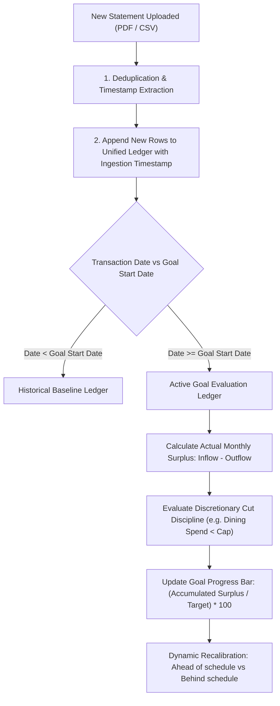

# Goal Tracking Lifecycle & Delta Statement Ingestion

> **Core Principle**: Historical statements establish the **Baseline Surplus Velocity**. Once a goal is created, future statements measure **Actual Progress** and **Goal Discipline** strictly starting from the goal's creation date.

---

## 1. The Timeline: Before vs. After Goal Creation

```
─────────────────────────────────────────────┬────────────────────────────────────────────► Time
          PAST STATEMENTS                    │              FUTURE STATEMENTS
      (Baseline Discovery Phase)             │           (Actual Tracking Phase)
                                             │
• 12-Month Historical Statement              │ • Month 13 Statement (Nov 2026)
• Analyzes typical monthly burn rate         │ • Month 14 Statement (Dec 2026)
• Discovers unallocated surplus:             │ • Tracks actual savings against goal
  ₹1,05,000 (Income) - ₹88,000 (Burn)        │ • Evaluates budget cut compliance
  = ₹17,000/month baseline surplus           │
                                             │
                                     [ GOAL CREATED ]
                                    Date: 2026-10-31
                                    Target: ₹1,80,000
                                    Deadline: 8 Months
```

---

## 2. What Happens When a New Statement is Uploaded?

When a user uploads a new statement (e.g. Month 13: `statement_nov_2026.pdf`):



---

## 3. Step-by-Step Data Flow & Mathematics

### Step 1: Tagging Transactions with Dual Timestamps
Every transaction stored in the database has two dates:
1. `transaction_date` (e.g. `2026-11-04`): The date the transaction actually happened at the bank.
2. `created_at` / `statement_id`: The date/batch when the statement was uploaded.

### Step 2: The Goal Entity Model
When the user creates a goal, the system stores:
```json
{
  "goal_id": "goal-japan-vacation",
  "name": "Japan Vacation",
  "target_amount": 180000.00,
  "start_date": "2026-10-31",
  "target_date": "2027-06-30",
  "committed_monthly_cut": 3500.00,
  "baseline_monthly_surplus": 15100.00,
  "current_saved_amount": 0.00
}
```

### Step 3: Filtering for Goal Evaluation
When calculating goal progress:
$$\text{Eligible Transactions} = \{ t \in \text{Ledger} \mid t.\text{transaction\_date} \ge \text{Goal}.\text{start\_date} \}$$

Transactions that occurred **before** the goal's creation date (`2026-10-31`) are **never counted as progress toward this goal**. They only serve as historical baseline data.

### Step 4: The Monthly Goal Reconciliation
At the end of each new month (e.g. November 2026):
1. **Actual Inflow**: ₹1,05,000
2. **Actual Outflow**: ₹83,500
3. **Actual Surplus Generated**: $\text{Inflow} - \text{Outflow} = ₹21,500$
4. **Goal Allocation**:
   $$\text{Current Saved Amount} = \text{Previous Saved Amount} + \text{Actual Surplus Generated}$$
   $$\text{Progress \%} = \left(\frac{₹21,500}{₹1,80,000}\right) \times 100 = 11.9\%$$

### Step 5: The "Discipline Feedback Loop"
The system verifies whether the user kept their commitment:
* User committed to: *"Keep Dining & Food Delivery below ₹9,000/month"*.
* Actual Dining Spend in November: ₹7,800.
* **UI Feedback**:
  > *"🎉 Goal Commitment Kept! You spent ₹7,800 on dining (saving ₹4,200 vs your baseline). You added ₹21,500 to your Japan Vacation fund — **you are 0.4 months ahead of schedule!**"*

---

## 4. What If the User Uploads Out-of-Order Statements?
If a user uploads a statement from 6 months ago that was missing:
1. Deduplication using `(date, narration, debit, credit)` ensures no row is counted twice.
2. The transaction dates determine where each record belongs chronologically.
3. Because the goal engine filters strictly by `transaction_date >= goal.start_date`, retroactively uploading old statements never corrupts the goal progress bar.
